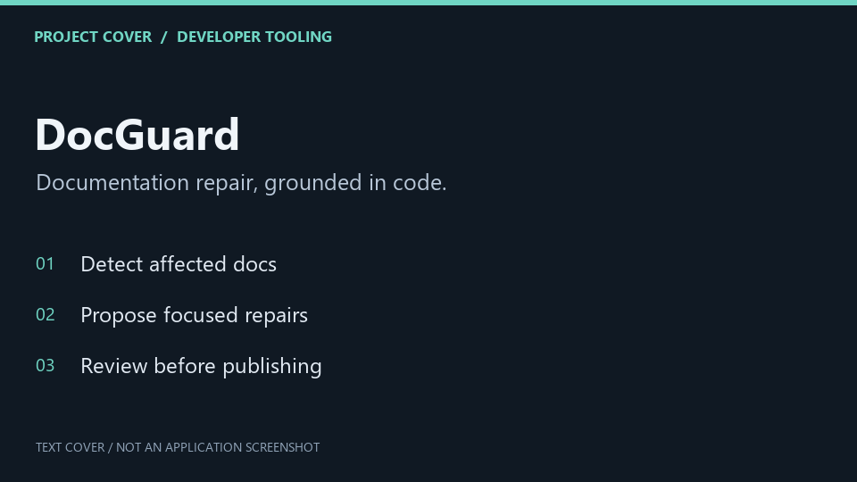
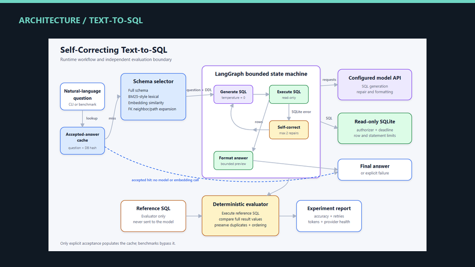
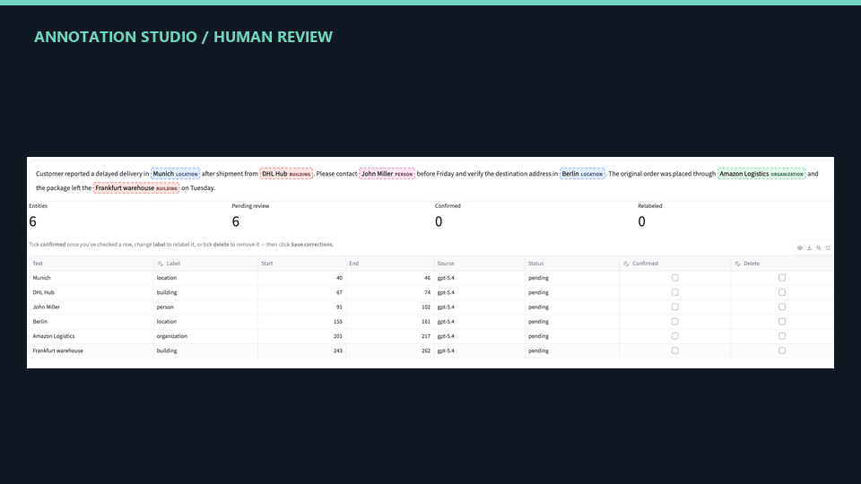
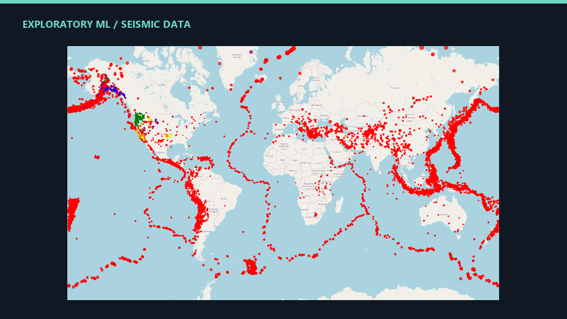
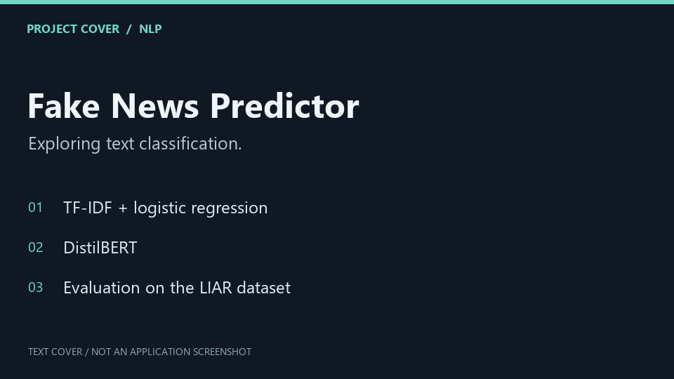
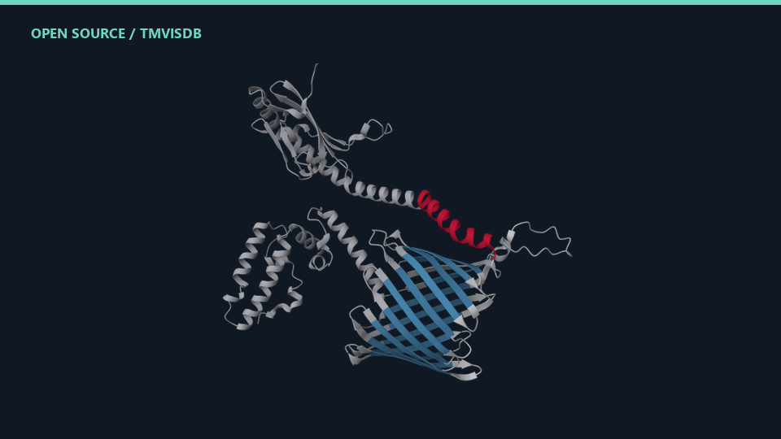

# Hey, I'm Amine

**Software Engineer | AI/ML | Intelligent Systems**

I build software at the intersection of machine learning, intelligent automation, and developer tooling. I'm interested in reliable systems, practical AI, and making complex workflows easier to use.

## Selected projects

My current focus: **documentation automation, LLM agents, and human-in-the-loop NLP.**

<table>
  <tr>
    <td width="50%" valign="top">
      
      <h3><a href="https://github.com/smaoui-me/docguard">DocGuard</a></h3>
      
Code-aware documentation review and repair proposals.

      
Python &middot; GitHub Actions &middot; Groq

      
<a href="https://github.com/smaoui-me/docguard">Explore code &rarr;</a>

    </td>
    <td width="50%" valign="top">
      
      <h3><a href="https://github.com/smaoui-me/self-correcting-text-to-sql">Self-Correcting Text-to-SQL</a></h3>
      
Natural-language queries with bounded SQL repair and evaluation.

      
Python &middot; LangGraph &middot; Groq &middot; SQLite

      
<a href="https://github.com/smaoui-me/self-correcting-text-to-sql">Explore code &rarr;</a>

    </td>
  </tr>
  <tr>
    <td width="50%" valign="top">
      
      <h3><a href="https://github.com/smaoui-me/genai-nlp-eval-framework-1-">GenAI NLP Evaluation Framework</a></h3>
      
Annotation studio for LLM suggestions, human review, and gold-data export.

      
Python &middot; Streamlit &middot; Docker

      
<a href="https://github.com/smaoui-me/genai-nlp-eval-framework-1-">Explore code &rarr;</a>

    </td>
    <td width="50%" valign="top">
      
      <h3><a href="https://github.com/smaoui-me/earthquake-predictor">Earthquake Predictor</a></h3>
      
Exploratory modeling with seismic and environmental data.

      
Python &middot; scikit-learn &middot; Jupyter

      
<a href="https://github.com/smaoui-me/earthquake-predictor">Explore code &rarr;</a>

    </td>
  </tr>
  <tr>
    <td width="50%" valign="top">
      
      <h3><a href="https://github.com/smaoui-me/fake-news-predictor">Fake News Predictor</a></h3>
      
Text classification with traditional ML and transformer models.

      
Python &middot; PyTorch &middot; Transformers &middot; scikit-learn

      
<a href="https://github.com/smaoui-me/fake-news-predictor">Explore code &rarr;</a>

    </td>
    <td width="50%" valign="top">
      
      <h3><a href="https://github.com/smaoui-me/TMVisDB">TMVisDB</a></h3>
      
<strong>Minor open-source contribution.</strong> A fork of <a href="https://github.com/t03i/TMVisDB">t03i/TMVisDB</a>, a transmembrane protein annotation and visualization project.

      
Project stack: SvelteKit &middot; TypeScript &middot; FastAPI &middot; SQLite

      
<a href="https://github.com/smaoui-me/TMVisDB">View fork &rarr;</a> &middot; <a href="https://tmvisdb.predictprotein.org">Upstream demo</a>

    </td>
  </tr>
</table>

Previews use repository screenshots, diagrams, and visualizations. DocGuard and Fake News Predictor use labeled text covers. TMVisDB visualization is from the upstream project.

<!-- Asset provenance (repository-relative paths; previews fitted, not cropped):
docguard.png: original text cover based on smaoui-me/docguard README.
text-to-sql.png: smaoui-me/self-correcting-text-to-sql, docs/assets/system-overview.svg (rasterized).
genai-evaluation.png: smaoui-me/genai-nlp-eval-framework-1-, docs/assets/annotation-review.png.
earthquake-predictor.png: smaoui-me/earthquake-predictor, world_map.png.
fake-news-predictor.png: original text cover based on smaoui-me/fake-news-predictor README.
tmvisdb.png: smaoui-me/TMVisDB, .github/images/Q9NVH1-tmbed.png; upstream t03i/TMVisDB, Apache-2.0.
Keep replacement previews at 960 x 540 (16:9) and preserve source attribution.
-->

## Technologies

## Connect

[GitHub](https://github.com/smaoui-me) &middot; LinkedIn: _to be added_ &middot; Email: _to be added_
